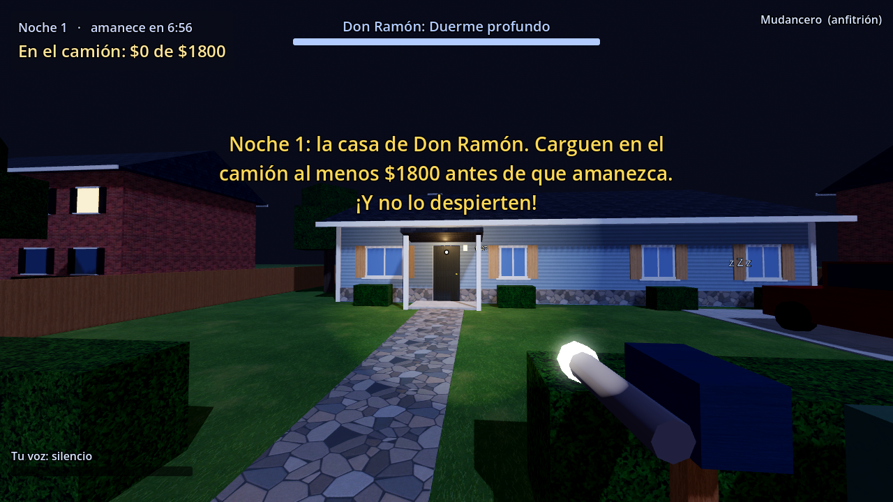
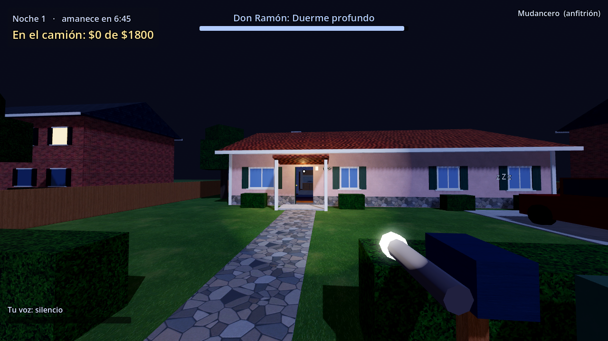
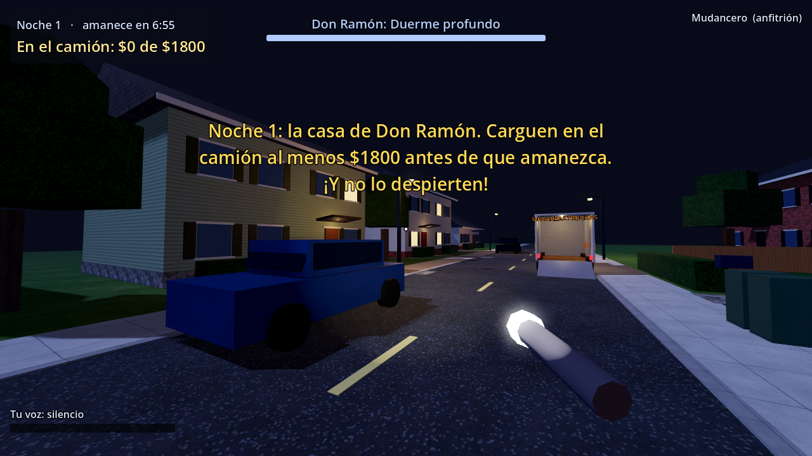
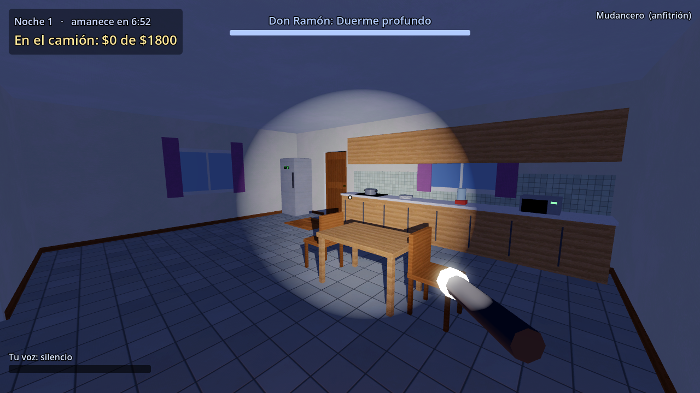
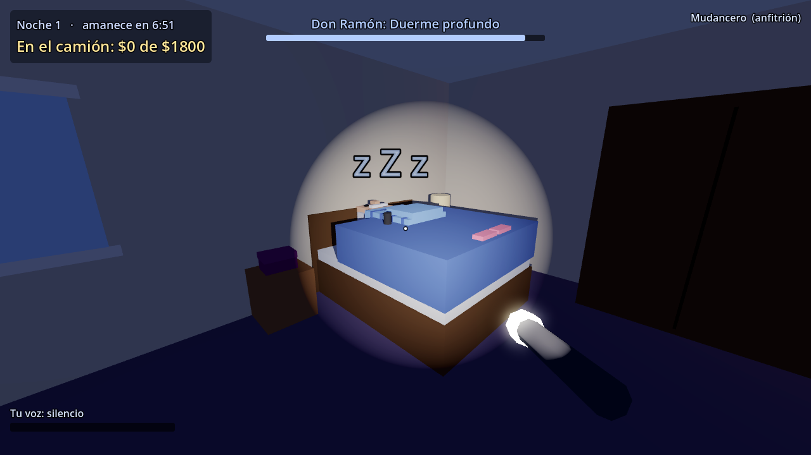
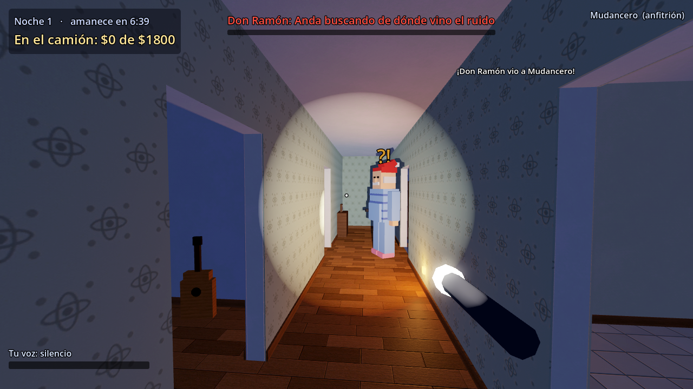

# Mudanceros Truchos (prototipo)

Cooperativo de 1 a 4 jugadores en primera persona. Son una empresa de mudanzas que de noche
"muda" casas sin permiso: hay que cargar el camión con lo que valga la pena **sin despertar a
Don Ramón**, el dueño, que duerme en su pieza. **El juego escucha el micrófono**: si alguien
habla fuerte o se ríe, Don Ramón se mueve en la cama. Si se despierta, sale a buscar con la
linterna.

Es el **primer prototipo** de la idea del [plan del juego](docs/plan-juego-steam.md) (sección 8):
solo la parte de la noche, para comprobar si el robo en silencio es divertido antes de agregar
la mudanza de día, más casas, arte y sonido de verdad.

| La casa de Don Ramón | Cada noche cambia de estilo |
|---|---|
|  |  |
| **El barrio y el camión en la calle** | **La cocina** |
|  |  |
| **El dormitorio** | **Don Ramón despierto, buscando** |
|  |  |

## Qué tiene el prototipo

- **La casa de Don Ramón:** sala, cocina, pasillo, dormitorio, estudio y baño, con 5 puertas
  (la del dormitorio chilla) y tablas del piso que crujen al pisarlas.
- **Texturas** (ladrillo, revestimiento de madera, estuco, tejas, pisos de madera, baldosas,
  alfombra, empapelados, pasto, asfalto, vereda, follaje...) con relieve, para que la linterna
  marque las juntas y la veta. Las genera `tools/generate_textures.py`: son propias, sin licencias.
- **Cada noche la casa es distinta:** cambia la fachada (madera de colores, ladrillo o estuco),
  el techo (tejas asfálticas o de arcilla), los postigos, la puerta, la pintura o el empapelado de
  cada cuarto, los pisos, las cortinas y la frazada. Todos los jugadores ven el mismo estilo.
- **El barrio:** siete casas vecinas distintas (de uno o dos pisos, con o sin garaje, ventanas
  prendidas o apagadas), autos estacionados, faroles, cercos vivos y un camino de piedra.
- **24 objetos con física:** televisor, consola, joyero (en el velador, al lado de su cabeza),
  notebook, caja fuerte, sillón, cuadros colgados... y cosas sin valor que solo hacen ruido
  (sillas, platos, una olla, un patito de hule). Lo frágil se rompe si se cae o se lanza.
- **Lo pesado se carga entre dos.** Una sola persona puede arrastrar el sillón o la caja fuerte,
  pero va lento y hace ruido.
- **El micrófono:** cada jugador mide su propio volumen. Lo que oye Don Ramón depende de lo
  fuerte que sea, la distancia y las paredes o puertas cerradas que haya en el medio.
  También hacen ruido los pasos (correr más, agacharse casi nada), las puertas, los golpes
  de los objetos y las tablas que crujen.
- **Don Ramón** tiene un nivel de alerta de 0 a 100: ronca → se mueve en la cama → está por
  despertarse → se levanta, prende la luz y va a ver qué fue el ruido. Si ve a alguien
  (le cuesta más si está agachado o detrás de un mueble; le es más fácil con la linterna
  prendida) lo persigue. Al que atrapa **lo tira a la calle y llama a la policía**: llega en
  60 segundos. Si no encuentra a nadie, vuelve a la cama... con el sueño más liviano.
- **El camión:** está estacionado en la calle, a unos 14 m de la puerta (más cerca, el motor
  despertaría a Don Ramón). Lo que está adentro de la caja de carga cuenta como botín. Para
  terminar la noche, alguien mantiene E en la puerta del conductor (la que da a la vereda). Los que se quedan adentro de la casa
  cuentan como detenidos (multa de $300 cada uno).
- **Resultados de la noche:** botín contra la cuota, de 0 a 3 estrellas y "premios":
  *El más ruidoso*, *Despertador humano* (quién lo despertó), *Manos de mantequilla*,
  *Imán de abuelos* y *Empleado del mes*. Después se puede jugar otra noche: la cuota sube
  y Don Ramón duerme más liviano.
- **Multijugador sin servidores:** un jugador es el anfitrión y los demás se conectan a él
  (por IP/red local, o por Steam con el plugin GodotSteam).
- **Sonidos generados por código** (provisorios: ronquido, vidrios rotos, chirrido de puertas,
  sirena) y gráficos de cajas de colores, estilo low-poly.

**La voz entre los jugadores todavía no viaja por el juego:** por ahora se habla por Discord
(o lo que usen). El juego solo mide el volumen de cada micrófono.

## Cómo abrirlo

1. Descargar **Godot 4.7** (la versión estándar, no la de .NET) desde <https://godotengine.org/download>.
2. Abrir Godot → **Importar** → elegir el archivo `project.godot` de esta carpeta.
3. Pulsar **F5** para jugar.

Usa el renderizador "Compatibilidad" (OpenGL), así funciona también en computadoras modestas.

**Micrófono:** el menú principal (y la pausa) tiene un medidor para probarlo, una casilla para
apagarlo y la sensibilidad. Lo ideal es que hablar normal marque "hablando" y susurrar marque
"susurro". Si el medidor no se mueve, revisar que el sistema le dé permiso a Godot de usar el
micrófono.

## Jugar con amigos

### Por IP o red local (para probar)

- Uno pulsa **Crear partida**; los demás escriben la IP del anfitrión y pulsan **Unirse por IP**.
- Usa el puerto **UDP 24567**. Por internet hay que abrir ese puerto en el router del anfitrión
  (por eso la versión para Steam usa los lobbies de Steam, que no necesitan abrir puertos).
- Para probar solo en una computadora: en el editor, **Depurar → Personalizar instancias de ejecución**,
  elegir 2 instancias y ponerles como argumentos `-- --host` a la primera y `-- --join=127.0.0.1` a la segunda.

### Por Steam

1. Instalar el plugin **GodotSteam** para Godot 4 (la versión GDExtension, con `SteamMultiplayerPeer`),
   desde la AssetLib del editor o desde <https://godotsteam.com>.
2. Tener Steam abierto. Mientras no haya un App ID propio se usa el **480 ("Spacewar")**, la app de prueba
   de Valve. El App ID se cambia en `scripts/autoload/net.gd` (`STEAM_APP_ID`).
3. Pulsar **Crear partida en Steam** → **Esc** → **Invitar amigos de Steam**. El amigo acepta la invitación
   desde Steam y entra directo a la partida.

> **Importante:** la parte de Steam está escrita según la API de GodotSteam, pero **todavía no se probó con
> Steam real** (en el entorno donde se programó no hay Steam). Si el plugin cambió algún nombre de función,
> el error va a aparecer en `scripts/autoload/net.gd`. El modo por IP sí está probado con pruebas automáticas.

## Controles

| Tecla | Acción |
|---|---|
| WASD | Moverse |
| Shift | Correr (hace más ruido) |
| C o Ctrl | Agacharse (casi no hace ruido y cuesta más verte) |
| Espacio | Saltar |
| Mouse | Mirar |
| E | Agarrar / soltar, abrir y cerrar puertas; mantener en la cabina del camión para irse |
| Clic izquierdo | Lanzar lo que se tiene en la mano (¡ruido!) |
| F | Prender / apagar la linterna |
| Esc | Pausa (micrófono, invitar amigos, salir) |
| F3 | Datos de depuración: alerta de Don Ramón en números y los últimos ruidos que oyó |

## Cómo se juega

1. Empiezan en la vereda, junto al camión. La cuota de la primera noche es de $1.800.
2. Cruzan el jardín por el camino de piedra y entran a la casa: la puerta de calle está cerrada,
   se abre con **E** (hace un poco de ruido). La de la cocina, atrás, también sirve.
3. Buscan lo que vale y lo llevan a la caja del camión. Lo chico se lleva en la mano; lo pesado, entre dos.
4. Arriba de la pantalla se ve cómo duerme Don Ramón. Si la barra se vacía, se despierta.
5. Cuando quieran irse (o si viene la policía), todos al camión y alguien mantiene E en la puerta del conductor.

## Estructura del proyecto

```
project.godot              Configuración (autoloads, micrófono, física Jolt, renderizador)
scenes/main.tscn           Escena principal (solo carga scripts/main.gd)
scripts/
  main.gd                  Menú ↔ partida; opciones de línea de comandos
  autoload/
    net.gd                 Conexión: ENet (IP) y Steam (GodotSteam, cargado de forma dinámica)
    voice.gd               Micrófono: mide el volumen de cada jugador
    controls.gd            Teclas y botones del mouse
    sfx.gd                 Sonidos generados por código
  core/
    config.gd              TODOS los números de balance (ruido, oído, vista, objetos, tiempos)
    mats.gd                Materiales y mallas compartidas
    fx.gd                  Partículas, destellos y textos flotantes
  world/
    world.gd               La partida: reglas, ruido, camión, policía, red (RPC)
    house_builder.gd       La casa, sus estilos, el barrio y el camión; puntos por donde camina el dueño
    house_owner.gd         Don Ramón: oído, vista y máquina de estados
    door.gd                Puertas con bisagra
  entities/entity.gd       Objetos físicos (lo que se roba y lo que solo hace ruido)
  player/player.gd         El mudancero en primera persona
  ui/hud.gd, ui/menu.gd    Interfaz (y resultados de la noche)
  dev/autotest.gd          Prueba automática anfitrión + cliente
  dev/photo_tour.gd        Recorrido de capturas de pantalla
assets/textures/           Texturas (color + relieve) generadas por tools/generate_textures.py
tools/generate_textures.py Generador de texturas (Python con numpy y Pillow)
docs/                      Plan del juego y capturas
```

**Cómo funciona la red:** el anfitrión simula todo (física, Don Ramón, puertas, ruido, botín). Cada
jugador mueve su propio mudancero y le manda al anfitrión su posición, si está agachado o con la
linterna, su nivel de voz y sus pedidos ("agarrar esto", "abrir esta puerta"). Quien entra a una
partida empezada recibe una "foto" completa del estado.

## Ajustar el balance

Todo está en `scripts/core/config.gd`. Lo más importante para probar con amigos:

- `HEARING_DISTANCE`, `WALL_FACTOR` y `HEARING_FLOOR`: qué tan bien oye Don Ramón.
- `ALERT_DECAY`: qué tan rápido se le pasa el susto cuando hay silencio.
- `NOISE_*`: cuánto ruido hace cada cosa (pasos, tablas, arrastrar, romper).
- `OWNER_*`: velocidad, distancia a la que ve y cuánto tarda en rendirse.
- `ITEMS`: valor, peso y fragilidad de cada objeto.

Los estilos de casa están en `scripts/world/house_builder.gd` (`FACADES`, `PAINTS`, `PAPERS`,
`WOODS`, `CARPETS`, `TILES`). Para cambiar una textura: editar `tools/generate_textures.py`,
correr `python3 tools/generate_textures.py` y abrir el proyecto en Godot (las reimporta solo).

F3 muestra en el juego la alerta en números y los últimos ruidos que oyó, con cuánto subió cada uno.

## Pruebas automáticas

Recorren las mecánicas principales con un anfitrión y un cliente reales conectados por red:
que la voz suba la alerta (y que un susurro lejos no), la puerta que chilla, cargar el joyero en
el camión, romper el jarrón, el sillón entre dos (y arrastrado por uno), que Don Ramón se
despierte, persiga y eche a alguien, irse y empezar otra noche. Al final comprueban que el
cliente vea lo mismo que el anfitrión.

```sh
godot --headless --path . -- --host --autotest --expect=1 &
godot --headless --path . -- --join=127.0.0.1 --autotest
```

Cada una termina con `AUTOTEST OK` (o con la lista de lo que falló). También hay un recorrido que guarda
capturas de pantalla: `godot --path . -- --host --tour=/carpeta/de/salida`.

## Próximos pasos

- **Probarlo con amigos** y ajustar el oído de Don Ramón: es lo único que dice si es divertido.
- **Voz por proximidad dentro del juego** (con la API de voz de Steam): escuchar a los demás más
  fuerte cuanto más cerca estén. Es la mitad de la gracia en los clips.
- La **mudanza de día** (ver el plan): ver la casa por dentro antes de robarla.
- Más casas para robar con otra distribución de cuartos (la abuela con gatos, el policía
  jubilado, la mansión) y la barra de sospecha.
- Modelos de verdad para los muebles y los personajes, sonidos y música.
- Abrir la página "Próximamente" en Steam lo antes posible para juntar wishlists.

El prototipo anterior (*Mineros Endeudados*) sigue en el historial de git, en el commit `6a41459`.
