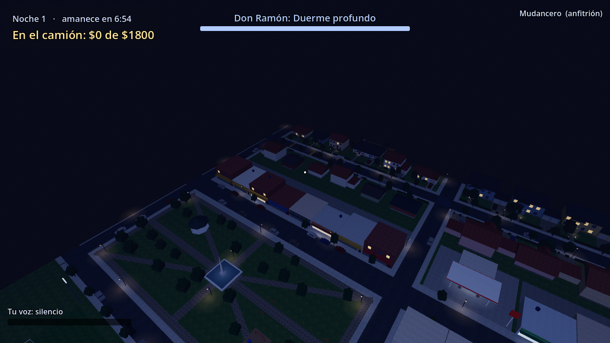
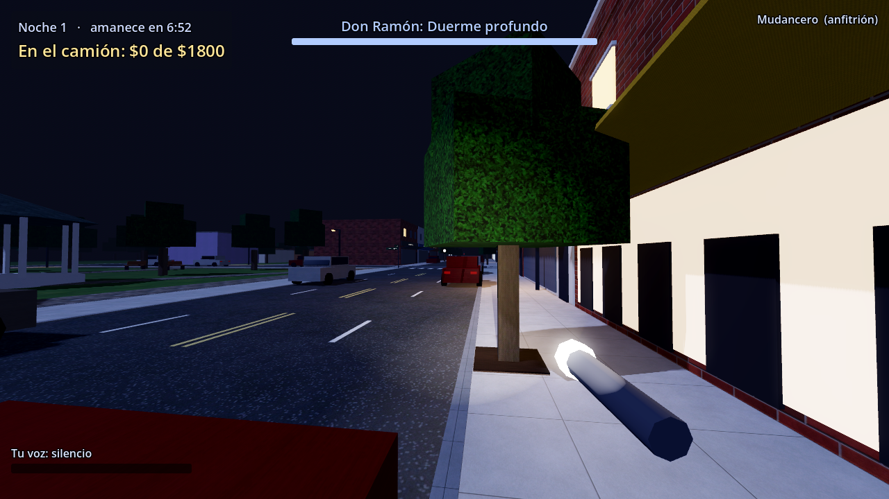
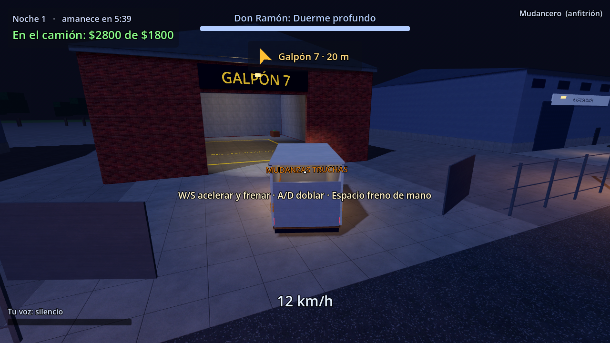
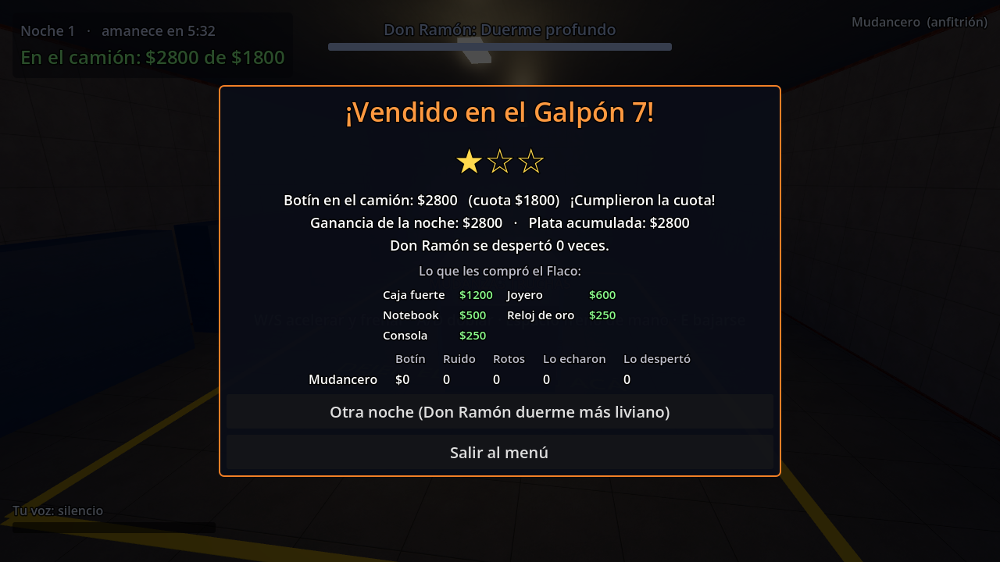
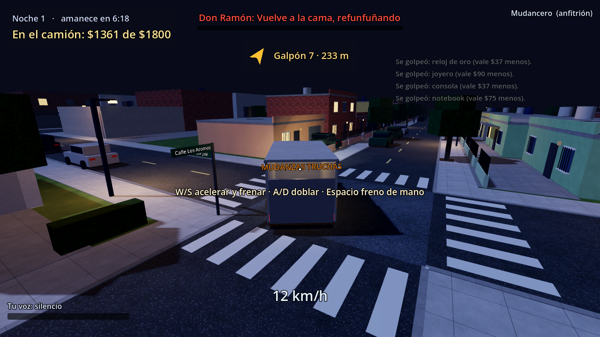
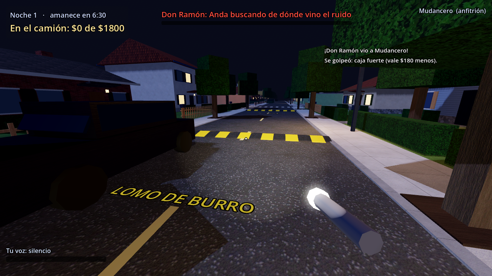
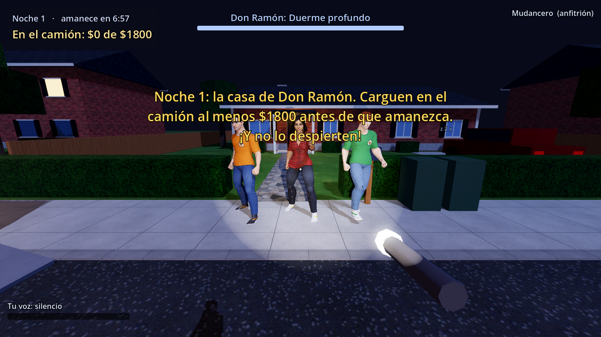

# Mudanceros Truchos (prototipo)

Cooperativo de 1 a 4 jugadores en primera persona. Son una empresa de mudanzas que de noche
"muda" casas sin permiso: hay que cargar el camión con lo que valga la pena **sin despertar a
Don Ramón**, el dueño, que duerme en su pieza. **El juego escucha el micrófono**: si alguien
habla fuerte o se ríe, Don Ramón se mueve en la cama. Si se despierta, sale a buscar con la
linterna. Después hay que cruzar la ciudad manejando hasta el **Galpón 7**, donde el reducidor
compra todo lo que llevan en la caja.

Es el **primer prototipo** de la idea del [plan del juego](docs/plan-juego-steam.md) (sección 8):
solo la parte de la noche, para comprobar si el robo en silencio es divertido antes de agregar
la mudanza de día, más casas, arte y sonido de verdad.

| La casa de Don Ramón | Cada noche cambia de estilo |
|---|---|
|  |  |
| **El barrio y el camión en la calle** | **La cocina** |
|  |  |
| **El dormitorio** | **Don Ramón despierto, buscando** |
|  |  |
| **La ciudad desde arriba** | **La avenida, con los comercios** |
|  |  |
| **Rumbo al Galpón 7 (la flecha marca el camino)** | **El Flaco les compra todo** |
|  |  |
| **Manejando por el barrio** | **El lomo de burro (despacio, que se rompe todo)** |
|  |  |
| **Los mudanceros (uno por jugador)** | |
|  | |

## Qué tiene el prototipo

- **La casa de Don Ramón:** sala, cocina, pasillo, dormitorio, estudio y baño, con 5 puertas
  (la del dormitorio chilla) y tablas del piso que crujen al pisarlas.
- **Texturas** (ladrillo, revestimiento de madera, estuco, tejas, pisos de madera, baldosas,
  alfombra, empapelados, pasto, asfalto, vereda, follaje...) con relieve, para que la linterna
  marque las juntas y la veta. Las genera `tools/generate_textures.py`: son propias, sin licencias.
- **Cada noche la casa es distinta:** cambia la fachada (madera de colores, ladrillo o estuco),
  el techo (tejas asfálticas o de arcilla), los postigos, la puerta, la pintura o el empapelado de
  cada cuarto, los pisos, las cortinas y la frazada. Todos los jugadores ven el mismo estilo.
- **La ciudad:** calles en cuadrícula que se conectan entre sí, con esquinas, sendas peatonales
  y carteles con el nombre de cada calle. Tres barrios pegados, cada uno con su estilo:
  **Villa Esperanza** (casas angostas de techo plano, tanque de agua y rejas), **Los Aromos**
  (el de Don Ramón: casas de madera o ladrillo con jardín) y **Las Lomas** (casas grandes de dos
  pisos, garaje doble y ligustro). La **Avenida Central** tiene comercios (panadería, ferretería,
  farmacia de turno, pizzería, kiosco 24 hs, bar...), una **estación de servicio** y la **plaza**
  con su obelisco, glorieta y juegos. Al norte hay una cancha de fútbol; cruzando las **vías del
  tren** (paso a nivel), la **zona industrial** con galpones, contenedores y camiones viejos.
  Hay autos estacionados, faroles, árboles y ventanas prendidas por todos lados.
- **24 objetos con física:** televisor, consola, joyero (en el velador, al lado de su cabeza),
  notebook, caja fuerte, sillón, cuadros colgados... y cosas sin valor que solo hacen ruido
  (sillas, platos, una olla, un patito de hule). Lo frágil se rompe si se cae o se lanza.
- **Lo pesado se carga entre dos.** Una sola persona puede arrastrar el sillón o la caja fuerte,
  pero va lento y hace ruido.
- **El micrófono:** cada jugador mide su propio volumen. Lo que oye Don Ramón depende de lo
  fuerte que sea, la distancia y las paredes o puertas cerradas que haya en el medio.
  También hacen ruido los pasos (correr más, agacharse casi nada), las puertas, los golpes
  de los objetos y las tablas que crujen.
- **Don Ramón** tiene un nivel de alerta de 0 a 100: ronca → se mueve en la cama → está por
  despertarse → se levanta, prende la luz y va a ver qué fue el ruido. Si ve a alguien
  (le cuesta más si está agachado o detrás de un mueble; le es más fácil con la linterna
  prendida) lo persigue. Al que atrapa **lo tira a la calle y llama a la policía**: llega en
  60 segundos. Si no encuentra a nadie, vuelve a la cama... con el sueño más liviano.
- **El camión:** está estacionado en la calle, a unos 14 m de la puerta. Lo que está adentro de
  la caja de carga cuenta como botín. Se maneja de verdad: ruedas con suspensión, motor, frenos,
  faros que alumbran y sombra. Uno se sube a manejar (E en la puerta del conductor, del lado de
  la calle) y los demás de acompañantes (E en la puerta de la vereda o en la rampa de atrás).
  El motor hace ruido: arrancar al lado de la casa también se oye.
- **El Galpón 7 y el reducidor:** su base, en la zona industrial (a unos 400 m manejando).
  Por fuera y por dentro aparenta ser el taller de una empresa de **mudanzas y reparaciones del
  hogar**: banco de trabajo, herramientas colgadas, estanterías con pintura y materiales,
  escaleras, cajas de mudanza, un sillón viejo y una oficinita. Arriba de la pantalla, una flecha
  marca hacia dónde queda y a cuántos metros.
- **La computadora del Flaco:** con el camión adentro del galpón, uno se sienta en el escritorio
  de la oficina (**E**) y su mudancero se pone a teclear. En la pantalla se abre una computadora
  vieja con el **Mercado del Flaco**: la lista de lo que hay en la caja del camión, con lo que paga
  por cada cosa (menos si está golpeada). Se vende de a una o todo junto, y al final se aprieta
  **Cerrar la noche**. Los demás ven al compañero sentado escribiendo y les llega un aviso por
  cada venta. (El ícono de la tienda de herramientas ya está, para más adelante.) Reglas:
  - **Se cobra al cerrar la noche.** Si lo vendido no llega a la cuota, el encargo se cancela y
    no cobran nada (la computadora lo avisa bien claro antes de cerrar).
  - **Si amanece** y ya le vendieron algo al Flaco, la noche se cierra sola con eso; si no le
    vendieron nada, hay que devolver todo. Un minuto antes avisa.
  - Lo que no vendan se pierde: la noche siguiente empieza de cero.
  - **La policía** (llega 60 s después de que Don Ramón agarra a alguien): si encuentra el camión
    todavía en el barrio, los agarra con todo. Si ya se fueron, solo detiene a los que se
    quedaron cerca de la casa (multa de $300 cada uno).
  - Los que no llegan al galpón (ni arriba del camión ni a pie) también pagan la multa.
- **Cuidado con lo de la caja:** va suelto, así que un choque, un **lomo de burro** o el **paso a
  nivel** pasado rápido lo sacude: lo frágil se rompe (el jarrón desde unos 23 km/h, el
  televisor desde unos 39) y lo demás **se golpea**. Cada golpe fuerte le baja el precio un 15 %
  (hasta tres golpes), y el Flaco lo paga así. Pasado el límite de 25 km/h, la pantalla avisa
  "¡Despacio!". La culpa es del que maneja.
- **Resultados de la noche:** botín contra la cuota, la lista de lo que compró el Flaco (con lo
  golpeado marcado), de 0 a 3 estrellas y "premios":
  *El más ruidoso*, *Despertador humano* (quién lo despertó), *Manos de mantequilla*,
  *Imán de abuelos* y *Empleado del mes*. Después se puede jugar otra noche: la cuota sube
  y Don Ramón duerme más liviano.
- **Multijugador sin servidores:** un jugador es el anfitrión y los demás se conectan a él
  (por IP/red local, o por Steam con el plugin GodotSteam).
- **Personas animadas:** los mudanceros (uno distinto por jugador) y Don Ramón tienen cuerpo,
  cara y ropa en capas (remera, camisa, jean, pijama, zapatillas, pantuflas), armados en Blender
  con la herramienta de `tools/personajes/`. Caminan, corren, se agachan y alumbran con las
  animaciones de Quaternius; el propio jugador no ve su cuerpo, pero sí su sombra.
- **Sonidos generados por código** (provisorios: ronquido, vidrios rotos, chirrido de puertas,
  sirena); la casa y los muebles son de cajas con texturas, estilo low-poly.

**La voz entre los jugadores todavía no viaja por el juego:** por ahora se habla por Discord
(o lo que usen). El juego solo mide el volumen de cada micrófono.

## Cómo abrirlo

1. Descargar **Godot 4.7** (la versión estándar, no la de .NET) desde <https://godotengine.org/download>.
2. Abrir Godot → **Importar** → elegir el archivo `project.godot` de esta carpeta.
3. Pulsar **F5** para jugar.

Usa el renderizador "Compatibilidad" (OpenGL), así funciona también en computadoras modestas.

**Micrófono:** el menú principal (y la pausa) tiene un medidor para probarlo, una casilla para
apagarlo y la sensibilidad. Lo ideal es que hablar normal marque "hablando" y susurrar marque
"susurro". Si el medidor no se mueve, revisar que el sistema le dé permiso a Godot de usar el
micrófono.

## Jugar con amigos

### Por IP o red local (para probar)

- Uno pulsa **Crear partida**; los demás escriben la IP del anfitrión y pulsan **Unirse por IP**.
- Usa el puerto **UDP 24567**. Por internet hay que abrir ese puerto en el router del anfitrión
  (por eso la versión para Steam usa los lobbies de Steam, que no necesitan abrir puertos).
- Para probar solo en una computadora: en el editor, **Depurar → Personalizar instancias de ejecución**,
  elegir 2 instancias y ponerles como argumentos `-- --host` a la primera y `-- --join=127.0.0.1` a la segunda.

### Por Steam

1. Instalar el plugin **GodotSteam** para Godot 4 (la versión GDExtension, con `SteamMultiplayerPeer`),
   desde la AssetLib del editor o desde <https://godotsteam.com>.
2. Tener Steam abierto. Mientras no haya un App ID propio se usa el **480 ("Spacewar")**, la app de prueba
   de Valve. El App ID se cambia en `scripts/autoload/net.gd` (`STEAM_APP_ID`).
3. Pulsar **Crear partida en Steam** → **Esc** → **Invitar amigos de Steam**. El amigo acepta la invitación
   desde Steam y entra directo a la partida.

> **Importante:** la parte de Steam está escrita según la API de GodotSteam, pero **todavía no se probó con
> Steam real** (en el entorno donde se programó no hay Steam). Si el plugin cambió algún nombre de función,
> el error va a aparecer en `scripts/autoload/net.gd`. El modo por IP sí está probado con pruebas automáticas.

## Controles

| Tecla | Acción |
|---|---|
| WASD | Moverse |
| Shift | Correr (hace más ruido) |
| C o Ctrl | Agacharse (casi no hace ruido y cuesta más verte) |
| Espacio | Saltar |
| Mouse | Mirar |
| E | Agarrar / soltar, abrir y cerrar puertas; subirse al camión y bajarse (parado) |
| Clic izquierdo | Lanzar lo que se tiene en la mano (¡ruido!) |
| F | Prender / apagar la linterna |
| Esc | Pausa (micrófono, invitar amigos, salir) |
| F3 | Datos de depuración: alerta de Don Ramón en números y los últimos ruidos que oyó |

Arriba del camión, el que maneja usa **W / S** para acelerar y frenar (o marcha atrás), **A / D**
para doblar y **Espacio** como freno de mano.

## Cómo se juega

1. Empiezan en la vereda, junto al camión. La cuota de la primera noche es de $1.800.
2. Cruzan el jardín por el camino de piedra y entran a la casa: la puerta de calle está cerrada,
   se abre con **E** (hace un poco de ruido). La de la cocina, atrás, también sirve.
3. Buscan lo que vale y lo llevan a la caja del camión. Lo chico se lleva en la mano; lo pesado, entre dos.
4. Arriba de la pantalla se ve cómo duerme Don Ramón. Si la barra se vacía, se despierta.
5. Cuando tengan la cuota (o si viene la policía), todos arriba del camión y a manejar hasta el
   **Galpón 7**: la flecha de arriba marca el camino. Despacio por los lomos de burro y el paso a
   nivel, que lo de la caja se rompe o se golpea. Adentro del galpón, dejen el camión sobre el
   rectángulo amarillo, siéntense en la computadora de la oficina, véndanle al Flaco y cierren la
   noche.

## Estructura del proyecto

```
project.godot              Configuración (autoloads, micrófono, física Jolt, renderizador)
scenes/main.tscn           Escena principal (solo carga scripts/main.gd)
scripts/
  main.gd                  Menú ↔ partida; opciones de línea de comandos
  autoload/
    net.gd                 Conexión: ENet (IP) y Steam (GodotSteam, cargado de forma dinámica)
    voice.gd               Micrófono: mide el volumen de cada jugador
    controls.gd            Teclas y botones del mouse
    sfx.gd                 Sonidos generados por código
  core/
    config.gd              TODOS los números de balance (ruido, oído, vista, objetos, tiempos)
    mats.gd                Materiales y mallas compartidas
    fx.gd                  Partículas, destellos y textos flotantes
  world/
    world.gd               La partida: reglas, ruido, camión, policía, red (RPC)
    house_builder.gd       La casa, sus estilos y su patio; puntos por donde camina el dueño
    city_builder.gd        La ciudad: calles, barrios, comercios, plaza, zona industrial y el Galpón 7
    mesh_batch.gd          Junta miles de cajas en pocas mallas (para que la ciudad ande en la web)
    truck.gd               El camión: física de vehículo, asientos, rampa, faros y sacudones de la caja
    house_owner.gd         Don Ramón: oído, vista y máquina de estados
    door.gd                Puertas con bisagra
  entities/entity.gd       Objetos físicos (lo que se roba y lo que solo hace ruido)
  entities/character_model.gd  Una persona animada (modelo + animaciones)
  player/player.gd         El mudancero en primera persona
  ui/hud.gd, ui/menu.gd    Interfaz (y resultados de la noche)
  dev/autotest.gd          Prueba automática anfitrión + cliente
  dev/photo_tour.gd        Recorrido de capturas de pantalla
  dev/autopilot.gd         Piloto automático (maneja hasta el Galpón 7 en las pruebas y las fotos)
assets/textures/           Texturas (color + relieve) generadas por tools/generate_textures.py
assets/characters/         Personajes (glTF) y animaciones (animaciones.glb), de tools/personajes/
.claude/                   El "estudio" de IA: agentes, skills, hooks y reglas
CLAUDE.md, project.yaml    Configuración del estudio para este proyecto
design/, production/       Documentos de diseño y de producción que crean los comandos del estudio
tools/generate_textures.py Generador de texturas (Python con numpy y Pillow)
tools/personajes/          Herramienta de Blender que arma los personajes (ver abajo)
docs/                      Plan del juego y capturas
```

**Cómo funciona la red:** el anfitrión simula todo (física, Don Ramón, puertas, ruido, botín). Cada
jugador mueve su propio mudancero y le manda al anfitrión su posición, si está agachado o con la
linterna, su nivel de voz y sus pedidos ("agarrar esto", "abrir esta puerta"). Quien entra a una
partida empezada recibe una "foto" completa del estado.

## Personajes (cómo se arman)

Los personajes salen de `tools/personajes/armar.py`, que corre en **Blender** (como módulo de
Python, `pip install bpy`). Parte del cuerpo base de Quaternius, le cambia las proporciones, le
pinta una piel propia (con pecas, rubor o arrugas a elección) y modela cada prenda sobre el cuerpo
como una pieza aparte (con grosor de tela, dobladillos, costuras, bolsillos y botones). Las
recetas de cada personaje (ropa, colores, peinado, tono de piel) están al principio de `armar.py`.

```sh
python3 -m venv .venv-blender && .venv-blender/bin/pip install bpy==5.2.2 pillow
python3 tools/personajes/descargar_fuentes.py        # paquetes de Quaternius (CC0), a fuentes/
cd tools/personajes && ../../.venv-blender/bin/python armar.py mudancero mudancera mudancero2 ramon
```

Escribe los modelos en `assets/characters/`. **Créditos:** cuerpos base, peinados y animaciones
de [Quaternius](https://quaternius.com) (Universal Base Characters y Universal Animation
Library), licencia CC0 (dominio público).

## Ajustar el balance

Todo está en `scripts/core/config.gd`. Lo más importante para probar con amigos:

- `HEARING_DISTANCE`, `WALL_FACTOR` y `HEARING_FLOOR`: qué tan bien oye Don Ramón.
- `ALERT_DECAY`: qué tan rápido se le pasa el susto cuando hay silencio.
- `NOISE_*`: cuánto ruido hace cada cosa (pasos, tablas, arrastrar, romper).
- `OWNER_*`: velocidad, distancia a la que ve y cuánto tarda en rendirse.
- `ITEMS`: valor, peso y fragilidad de cada objeto.
- `TRUCK_*` y `BUMP_*`: velocidad del camión, desde cuándo avisa "¡Despacio!" y qué tan fuerte
  sacude un lomo de burro.
- `DENT_*`, `SALE_*` y `BARRIO_RADIUS`: cuánto baja el precio lo golpeado, cuánto hay que quedarse
  parado en el galpón y hasta dónde llega "el barrio" para la policía.

Los estilos de casa están en `scripts/world/house_builder.gd` (`FACADES`, `PAINTS`, `PAPERS`,
`WOODS`, `CARPETS`, `TILES`). El trazado de la ciudad (calles, nombres, comercios, galpones) está
en `scripts/world/city_builder.gd`. Para cambiar una textura: editar `tools/generate_textures.py`,
correr `python3 tools/generate_textures.py` y abrir el proyecto en Godot (las reimporta solo).

F3 muestra en el juego la alerta en números y los últimos ruidos que oyó, con cuánto subió cada uno.

## Pruebas automáticas

Recorren las mecánicas principales con un anfitrión y un cliente reales conectados por red:
que la voz suba la alerta (y que un susurro lejos no), la puerta que chilla, cargar el joyero en
el camión, romper el jarrón, el sillón entre dos (y arrastrado por uno), que Don Ramón se
despierte, persiga y eche a alguien, subirse a manejar con un acompañante, arrancar, frenar,
bajarse, pasar un lomo de burro despacio (el televisor llega entero) y otro rápido (se rompe, y
el joyero se golpea y vale menos), manejar por la ciudad hasta el Galpón 7 con un piloto
automático, bajarse, sentarse en la computadora (y que otro no pueda si está ocupada), vender el
joyero y cerrar la noche, las cuentas de la venta (sin cuota, al amanecer o con la policía no se
cobra), empezar otra noche y que la policía los agarre con el camión en el barrio. Al final
comprueban que el cliente vea lo mismo que el anfitrión (también el camión y quién va sentado).

```sh
godot --headless --path . -- --host --autotest --expect=1 &
godot --headless --path . -- --join=127.0.0.1 --autotest
```

Cada una termina con `AUTOTEST OK` (o con la lista de lo que falló). También hay un recorrido que guarda
capturas de pantalla: `godot --path . -- --host --tour=/carpeta/de/salida` (con `--tour-city`
saca solo las de la ciudad, y con `--tour-drive` solo el viaje en camión hasta el galpón).

## Trabajar con el "estudio" de IA

El proyecto incluye [Claude Code Game Studios](https://github.com/Donchitos/Claude-Code-Game-Studios)
(licencia MIT, copia de la licencia en `.claude/LICENSE-claude-code-game-studios.txt`):
49 agentes especialistas (diseño, programación de Godot, QA, producción...) y comandos para
cada etapa. Está configurado para Godot 4.7 con GDScript, en el modo más liviano (`minimal`).
`CLAUDE.md` y `project.yaml` tienen la configuración.

Los comandos funcionan en una sesión de Claude Code abierta sobre esta carpeta. Los más útiles
para este momento:

| Comando | Para qué |
|---|---|
| `/help` | "¿Qué hago ahora?" |
| `/adopt` | La primera vez: revisa el proyecto y arma un plan para ordenarlo con la plantilla |
| `/playtest-report` | Después de jugar con amigos: convierte lo que pasó en una lista de cambios |
| `/balance-check` | Revisa los números (ruido, oído de Don Ramón, precios) buscando cosas rotas |
| `/bug-report` | Anotar un error con los pasos para reproducirlo |
| `/brainstorm` | Ideas nuevas (la mudanza de día, otras casas) |

Con esta plantilla, Claude pregunta antes de escribir cada archivo y no hace commits sin que se
lo pidan.

## Próximos pasos

- **Probarlo con amigos** y ajustar el oído de Don Ramón: es lo único que dice si es divertido.
- **Voz por proximidad dentro del juego** (con la API de voz de Steam): escuchar a los demás más
  fuerte cuanto más cerca estén. Es la mitad de la gracia en los clips.
- La **mudanza de día** (ver el plan): ver la casa por dentro antes de robarla, con la ciudad
  de día y gente en la calle.
- En el Galpón 7: **comprar herramientas** con lo ganado (ganzúas, carrito, linterna mejor) y
  **guardar la partida**.
- Más casas para robar con otra distribución de cuartos (la abuela con gatos, el policía
  jubilado, la mansión) y la barra de sospecha.
- Personajes: modelos realmente distintos (hombres y mujeres de distintas tez y contextura),
  sombreros y vello facial (barba, bigote) que convenzan; Don Ramón con los ojos cerrados al dormir.
- Modelos de verdad para los muebles, sonidos y música.
- Abrir la página "Próximamente" en Steam lo antes posible para juntar wishlists.

El prototipo anterior (*Mineros Endeudados*) sigue en el historial de git, en el commit `6a41459`.
